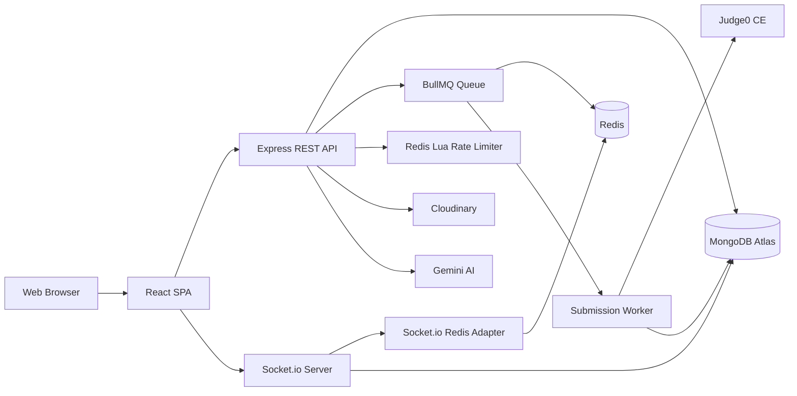

<div align="center">

# 🚀 CodeMaster

**A full-stack coding platform for college students — practice DSA, compete in timed contests, duel in real time, and learn together.**

[](https://react.dev/)
[](https://nodejs.org/)
[](https://www.mongodb.com/)
[](https://redis.io/)
[](https://docs.bullmq.io/)
[](https://socket.io/)
[](https://www.docker.com/)
[](https://k6.io/)
[](LICENSE)

[🔗 Live Demo](https://codemaster-frontend-ruddy.vercel.app/) · [📖 Technical Docs (HLD, API, DB Schema)](https://app.notion.com/p/CodeMaster-Complete-Technical-Documentation-3c3f128a4c3f807fa76ef3f0f3b3faa3) · [📈 Benchmark Report](backend/tests/BENCHMARK.md)

</div>

---

## 📑 Table of Contents

- [About](#-about)
- [Core Features](#-core-features)
- [Engineering Challenges Solved](#-engineering-challenges-solved)
- [Tech Stack](#️-tech-stack)
- [Architecture](#️-architecture)
- [Load Testing & Performance](#-load-testing--performance)
- [Getting Started](#-getting-started)
- [Project Structure](#-project-structure)
- [Environment Variables](#-environment-variables)
- [API Overview](#-api-overview)
- [Contributing](#-contributing)
- [License](#-license)
- [Acknowledgements](#-acknowledgements)
- [Contact](#-contact)

---

## 📌 About

**CodeMaster** is a MERN-stack online judge built around a **college-scoped ecosystem**. Students practice DSA problems, take part in timed coding and MCQ contests, challenge each other in **real-time 1v1 duels**, discuss in a community feed, and chat directly with admins.

What makes it different from a typical CRUD project: code execution is fully **asynchronous** (BullMQ + Redis), WebSockets are **horizontally scalable** (Socket.io Redis Adapter), and rate limiting is **atomic** (Redis Lua). The whole thing is load-tested with k6.

---

## ✨ Core Features

| | Feature | Details |
| :-: | :-- | :-- |
| 🧩 | **Practice Arena** | 1000+ DSA problems with search, difficulty/tag filters, infinite scroll |
| ⚡ | **Async Code Execution** | Sandboxed Judge0 CE (C++, Java, Python, JS) via BullMQ workers — non-blocking API |
| 🏆 | **Coding Contests** | Timed, public/private, live leaderboard, 3-strike tab-switch violation tracking |
| 📝 | **MCQ Contests** | Timed quizzes, server-side grading, detailed result breakdown |
| ⚔️ | **Real-time Duels** | 1v1 battles with ELO rating, live opponent progress, spectator mode |
| 🎓 | **College Management** | Multi-tenant — scoped contests and internal leaderboards per college |
| 💬 | **Admin Chat** | Students chat with an online admin; full history persisted |
| 📢 | **Community Feed** | Posts, comments, upvotes |
| 🎥 | **Video Solutions** | Cloudinary-backed explanations with auto-generated thumbnails |
| 🤖 | **AI Doubt Solver** | Gemini-powered hints, code review, complexity analysis |
| 📊 | **User Profiles** | Submission heatmap, skill breakdown, global & college rank |

---

## 🧠 Engineering Challenges Solved

Real problems hit (and fixed) during development — not just features shipped:

| Challenge | Root Cause | Solution |
| :-- | :-- | :-- |
| **HTTP threads blocked by Judge0** (15s+ p95) | Synchronous execution inside the request handler | Moved to a **BullMQ worker queue** on Redis; API now returns `202 Accepted` in <200ms |
| **Duplicate contest participants** under concurrent joins | Read-modify-write race on the `participants` array | Replaced with atomic **MongoDB `$addToSet`** |
| **Rate-limit bypass** under high concurrency | Multi-command `ZADD` + `ZCARD` sequence left a race window | Rewritten as a **single atomic Redis Lua script** |
| **WebSocket events lost across instances** | Socket state held in memory per instance | Added **Socket.io Redis Adapter** (Pub/Sub) for cross-instance broadcast |
| **Judge0 outages killed submissions** | No retry, no failure isolation | BullMQ **exponential backoff (3 retries)** + **dead-letter queue** |
| **Results never reached the client** | API returned before the worker finished | Worker pushes results over **Socket.io per-user rooms** |

---

## 🛠️ Tech Stack

| Layer | Technology | Libraries & Tools |
| :-- | :-- | :-- |
| **Frontend** | React 19 + Vite | Redux Toolkit, React Router, Tailwind CSS, Monaco Editor, Recharts |
| **Backend** | Node.js + Express | JWT, bcrypt, Mongoose, Socket.io, Nodemailer, Cloudinary SDK, Gemini API |
| **Database** | MongoDB Atlas | Mongoose ODM (23+ collections) |
| **Cache & Queue** | Redis (Upstash) | Token blacklist, refresh rotation, online presence, BullMQ |
| **Async Processing** | BullMQ | Submission worker, exponential backoff retries, DLQ |
| **Real-time** | Socket.io | Duels, live leaderboards, chat, Redis Adapter |
| **Code Execution** | Judge0 CE | Sandboxed multi-language execution |
| **Load Testing** | k6 | 100-VU concurrency benchmark |
| **DevOps** | Docker | Multi-stage frontend/backend builds |

---

## 🏗️ Architecture



### Key Decisions

- **Monolithic MVC backend** with strict layering (controllers → services → models).
- **Redis** backs queues, sessions, rate limits, and socket presence.
- **Judge0 never touches the API thread** — all heavy work lives in BullMQ workers.
- **Stateless HTTP layer** — any instance can serve any request; state lives in MongoDB + Redis.
- **Socket.io scales horizontally** through the Redis Pub/Sub adapter.

### Highlights

<details>
<summary><b>⚡ Async Code Execution (BullMQ)</b></summary>

Submissions are enqueued into Redis and return `202 Accepted` immediately. A separate worker process runs Judge0 evaluation with:

- 3 retries with exponential backoff
- Dead-letter queue for poison jobs
- Per-user Socket.io room delivery for real-time results

</details>

<details>
<summary><b>🌐 Horizontally Scalable WebSockets</b></summary>

The Redis Adapter broadcasts events between backend instances — a user connected to Server A receives messages emitted by a worker running on Server B.

</details>

<details>
<summary><b>🔒 Atomic Rate Limiting (Redis Lua)</b></summary>

The classic `ZADD` + `ZCARD` approach has a race window. This project runs the whole check as a single Lua script inside Redis, so the limit holds under heavy concurrency.

</details>

<details>
<summary><b>🧬 Race-Free Contest Registration</b></summary>

Concurrent joins used to create duplicate participants. MongoDB's `$addToSet` lets the database enforce uniqueness atomically.

</details>

---

## 📈 Load Testing & Performance

**Setup:** k6 · 100 concurrent VUs · 45 s · 2,600+ submissions · `POST /code/submit/:problemId`

| Metric | ☁️ Cloud (Atlas M0 + Upstash) | 🐳 Local (Docker) | Improvement |
| :-- | --: | --: | :-- |
| Average latency | 1.21 s | 18.86 ms | **64× faster** |
| p(95) latency | 1.55 s | 38.2 ms | **40× faster** |
| Minimum latency | 439 ms | 0.52 ms | **844× faster** |
| Total requests | 1,501 | 2,624 | **1.7× throughput** |
| Failure rate | 0.00% | 0.00% | ✅ Both perfect |

> **Key insight:** the gap isolates *infrastructure* latency (Atlas/Upstash network round-trips) from *application* latency, which stays under 20 ms. The async queue produced zero failures in both environments.

📄 Full report: [BENCHMARK.md](backend/tests/BENCHMARK.md)

**Reproduce locally:**

```bash
# Terminal 1
cd backend
SKIP_RATE_LIMIT=true npm run dev

# Terminal 2
k6 run tests/load-test.js
```

---

## 🚀 Getting Started

### Prerequisites

- Node.js **v18+**
- MongoDB (local or Atlas)
- Redis (local Docker or Upstash)
- A Judge0 CE instance

### 1. Clone

```bash
git clone https://github.com/manishs72660-collab/codermaster-project.git
cd codermaster-project
```

### 2. Backend

```bash
cd backend
npm install
```

Create `backend/.env`:

```env
PORT=3000
NODE_ENV=development
FRONTEND_URL=http://localhost:5173

CONNECT_STRING=your_mongodb_connection_string
REDISH_HOST=your_redis_host
REDISH_KEY=your_redis_password

JWT_KEY=your_jwt_secret
JWT_REFRESH_KEY=your_jwt_refresh_secret

GEMINI_KEY=your_gemini_api_key
CLOUDINARY_CLOUD_NAME=your_cloud_name
CLOUDINARY_API_KEY=your_api_key
CLOUDINARY_API_SECRET=your_api_secret
```

```bash
npm run dev   # http://localhost:3000
```

### 3. Frontend

```bash
cd ../frontend
npm install
```

Create `frontend/.env`:

```env
VITE_API_URL=http://localhost:3000
VITE_SOCKET_URL=http://localhost:3000
```

```bash
npm run dev   # http://localhost:5173
```

### 4. Verify

- Frontend → <http://localhost:5173>
- Backend → <http://localhost:3000> should return `{ "status": "Server is running" }`

---

## 📁 Project Structure

```text
codermaster-project/
├── backend/
│   ├── src/
│   │   ├── config/        # DB & Redis connections
│   │   ├── controller/    # Business logic
│   │   ├── middleware/    # Auth, rate limiting, role scoping
│   │   ├── models/        # Mongoose schemas (23+)
│   │   ├── queues/        # BullMQ queue definitions      ⭐
│   │   ├── workers/       # BullMQ worker processes       ⭐
│   │   ├── routes/        # Express routes
│   │   ├── socket/        # Socket.io event handlers
│   │   ├── utils/         # Judge0, ELO, email, Cloudinary
│   │   └── index.js       # Entry point
│   ├── tests/             # k6 load tests & benchmarks    ⭐
│   │   ├── load-test.js
│   │   ├── seed-users.js
│   │   ├── seed-problem.js
│   │   └── BENCHMARK.md
│   ├── Dockerfile
│   └── package.json
├── frontend/
│   ├── src/
│   │   ├── assets/
│   │   ├── components/
│   │   ├── pages/
│   │   ├── store/         # Redux slices
│   │   ├── utils/         # Axios client, socket client
│   │   ├── App.jsx
│   │   └── main.jsx
│   └── package.json
└── docs/                  # HLD, API reference
```

⭐ = added during the async / scaling refactor

---

## 🔐 Environment Variables

| Variable | Where | Description |
| :-- | :-- | :-- |
| `NODE_ENV=production` | Backend | Enables secure cookies (`secure: true`, `sameSite: 'none'`) |
| `FRONTEND_URL` | Backend | Production frontend URL (CORS allowlist) |
| `CONNECT_STRING` | Backend | MongoDB Atlas URI |
| `SKIP_RATE_LIMIT` | Backend | Set `true` **only** for local load testing |
| `VITE_API_URL` | Frontend | Production backend API URL |
| `VITE_SOCKET_URL` | Frontend | Production Socket.io URL |

---

## 📡 API Overview

| Group | Example Endpoints | Description |
| :-- | :-- | :-- |
| **Auth** | `POST /auth/register`, `/auth/login`, `/auth/refresh` | JWT with HTTP-only cookies |
| **Problems** | `GET /problem`, `POST /problem/create` | List, search, admin create |
| **Submissions** | `POST /code/submit/:id` → `202` | Async submission via BullMQ |
| **Contests** | `POST /contest/create`, `GET /contest/:id/leaderboard` | Full contest lifecycle |
| **MCQ Contests** | `POST /mcq-contest/:id/submit` | Server-side grading |
| **Duels** | `POST /duel/create`, `POST /duel/submit/:roomId` | ELO-rated 1v1 battles |
| **College** | `GET /collage/:collegeId/leaderboard` | Multi-tenant leaderboards |
| **Community** | `POST /community/posts/:id/upvote` | Feed interactions |
| **Video** | `GET /video/create/:problemId` | Cloudinary signed uploads |

Full reference: [Technical Documentation](https://app.notion.com/p/CodeMaster-Complete-Technical-Documentation-3c3f128a4c3f807fa76ef3f0f3b3faa3)

---

## 🤝 Contributing

1. Fork the repo
2. Create a branch: `git checkout -b feature/your-feature`
3. Commit using [Conventional Commits](https://www.conventionalcommits.org/) — e.g. `feat: add dark mode`
4. Push and open a PR against `develop`

**Code style:** ESLint + Prettier (Airbnb for backend, Standard for frontend).

---

## 📄 License

Distributed under the MIT License — see [LICENSE](LICENSE).

---

## 🙏 Acknowledgements

[Judge0](https://judge0.com/) · [BullMQ](https://bullmq.io/) · [Cloudinary](https://cloudinary.com/) · [Google Gemini](https://ai.google.dev/) · [MongoDB Atlas](https://www.mongodb.com/atlas) · [Upstash](https://upstash.com/)

---

## 📧 Contact

**Manish Singh** — [manishs72660@gmail.com](mailto:manishs72660@gmail.com)
Found a bug or have an idea? [Open an issue](https://github.com/manishs72660-collab/codermaster-project/issues).

<div align="center">

⭐ **If you find this project useful, give it a star!** ⭐

</div>